<div align="center">


# Orbyn

### From financial intent to intelligent execution.

An AI financial operations agent for freelancers and small businesses. Say what you need in plain words; Orbyn drafts the invoice, waits for your approval, and marks it paid only when PayPal confirms the money arrived.


**[Live app](https://orbyn-mu.vercel.app)** · **[Demo film](docs/DEMO.md)** · **[Architecture](docs/ARCHITECTURE.md)**

<br />

<a href="docs/media/orbyn-demo.webm">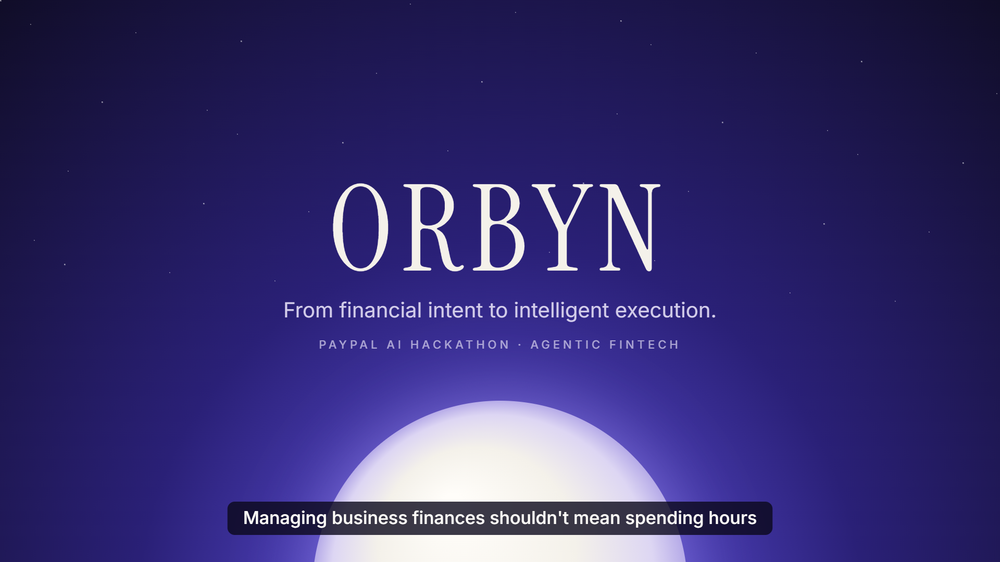</a>

<sub>2-minute demo recorded on the live site, including a real PayPal sandbox payment. <a href="docs/media/orbyn-demo.webm">Watch the film</a> · <a href="docs/DEMO.md">scene list and 90-second live demo</a></sub>

</div>

---

## The problem

Getting paid as a freelancer is a chain of small chores: write the invoice, send a payment link, check whether money came in, chase the late ones, then work out what you are still owed. Each step lives in a different screen, and none of them understands a plain sentence.

## The idea

Tell Orbyn the outcome you want. It turns the sentence into a concrete plan, shows it to you, and only acts once you approve. Money is never assumed: an invoice changes to paid only when PayPal confirms the capture, and every figure on screen comes from a database query, not from the model.

<div align="center">
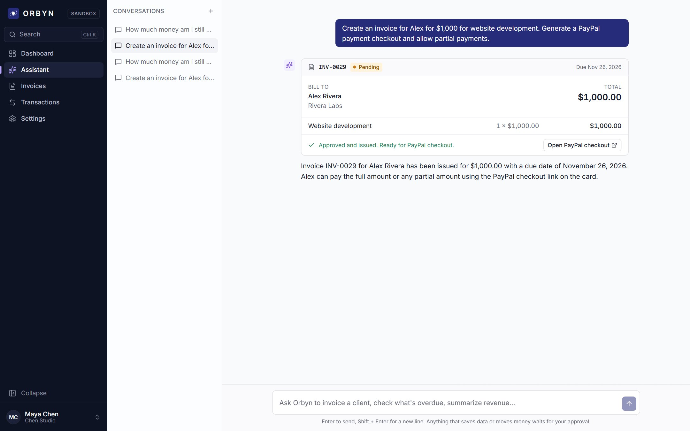
</div>

## What you get

| | Feature | What it does |
|---|---|---|
| 💬 | **Assistant** | Plain-English requests become drafted invoices, reminders and answers. Grouped suggestions, retry, Enter to send. |
| ✅ | **Approval gate** | The model can only draft. Issuing an invoice or scheduling a reminder needs your click, and approvals are signed by the server. |
| 💳 | **PayPal checkout** | Each invoice gets a private pay link with PayPal and card checkout (sandbox). |
| ➗ | **Partial payments** | Clients pay in full or any part; Orbyn tracks every capture and the remaining balance. |
| 🔒 | **Verified captures** | Paid means PayPal confirmed it. Captures are de-duplicated and listed with their PayPal ids. |
| ↩️ | **Refunds** | Full or partial refunds from the invoice page, reflected in net revenue. |
| 🔔 | **Reminders** | Polite, firm or final reminders, scheduled with approval, plus a daily sweep for overdue invoices. |
| 📊 | **Dashboard** | Month-to-date revenue against the same days last month, outstanding, overdue, and what needs attention. |
| 🧾 | **Invoices and transactions** | Status tabs with counts, search, pagination, date filters, verified-only filter and CSV export. |
| 👤 | **Accounts** | Email and password (argon2id), optional Google, password reset, active sessions, delete account. |
| 🧭 | **Onboarding** | Three steps: business profile, sample or empty data, PayPal sandbox status. One-time welcome tour. |
| 🧪 | **Live demo** | One click opens a private guest workspace with labelled sample data, and converts to a real account on sign-up. |
| ⌨️ | **Command palette** | Ctrl/⌘ K jumps to any page or common task. |
| 📱 | **Responsive** | Works from 375 px phones to wide desktops; tables become cards on small screens. |

## See it

### Landing and sign-in

<table>
<tr>
<td width="50%">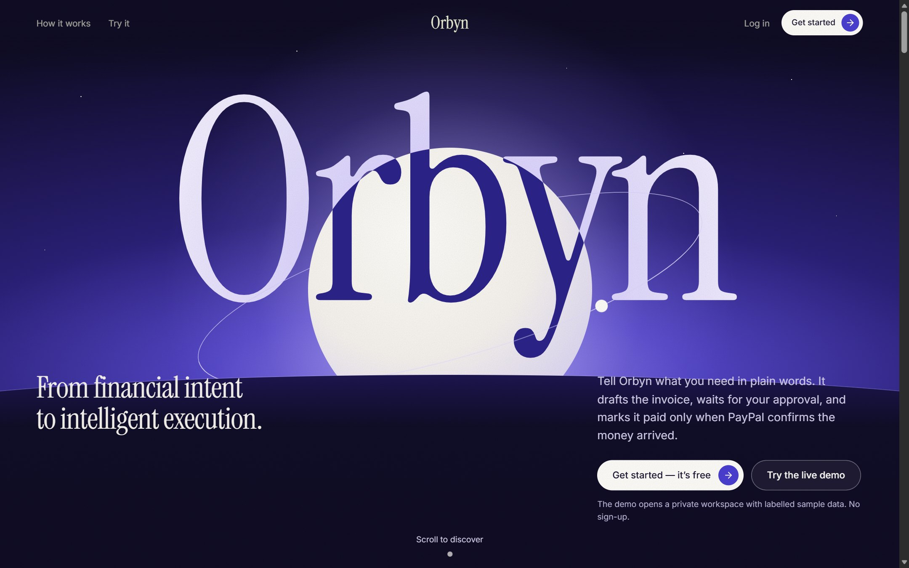<br /><sub><b>Landing.</b> Scroll-driven story, live demo in one click.</sub></td>
<td width="50%">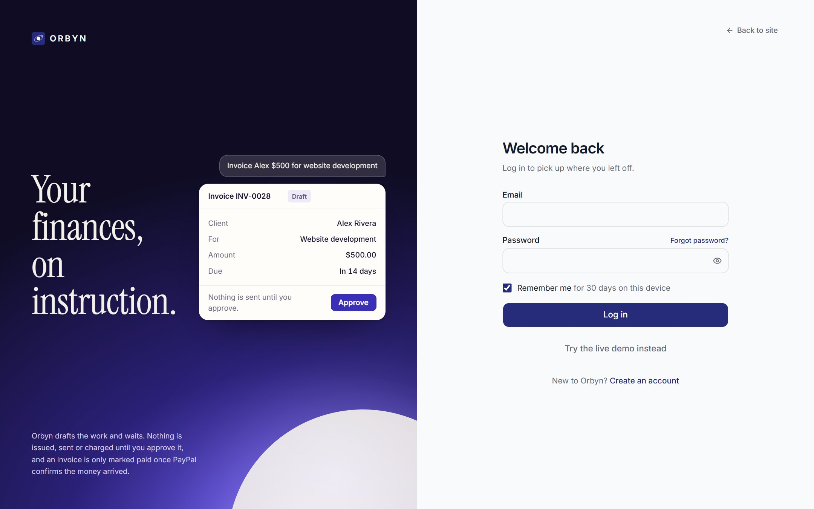<br /><sub><b>Log in.</b> Split screen with a looping plan preview.</sub></td>
</tr>
</table>

### The workspace

<table>
<tr>
<td width="50%">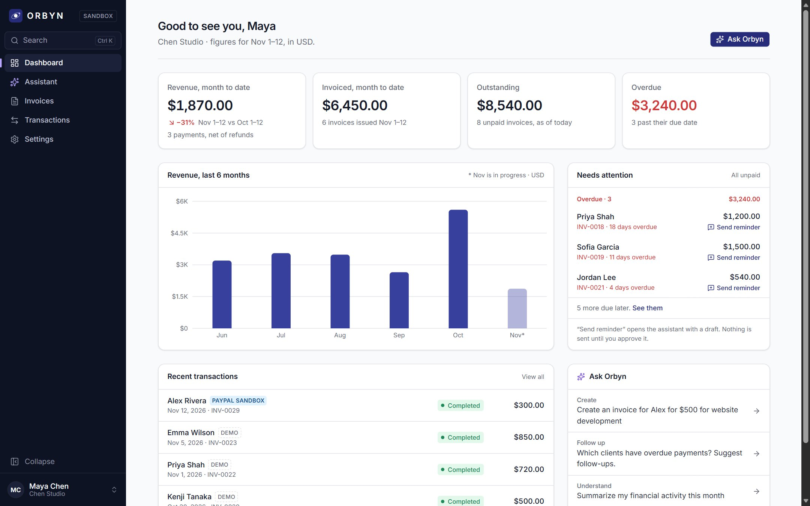<br /><sub><b>Dashboard.</b> Month to date vs the same days last month, and what needs attention.</sub></td>
<td width="50%">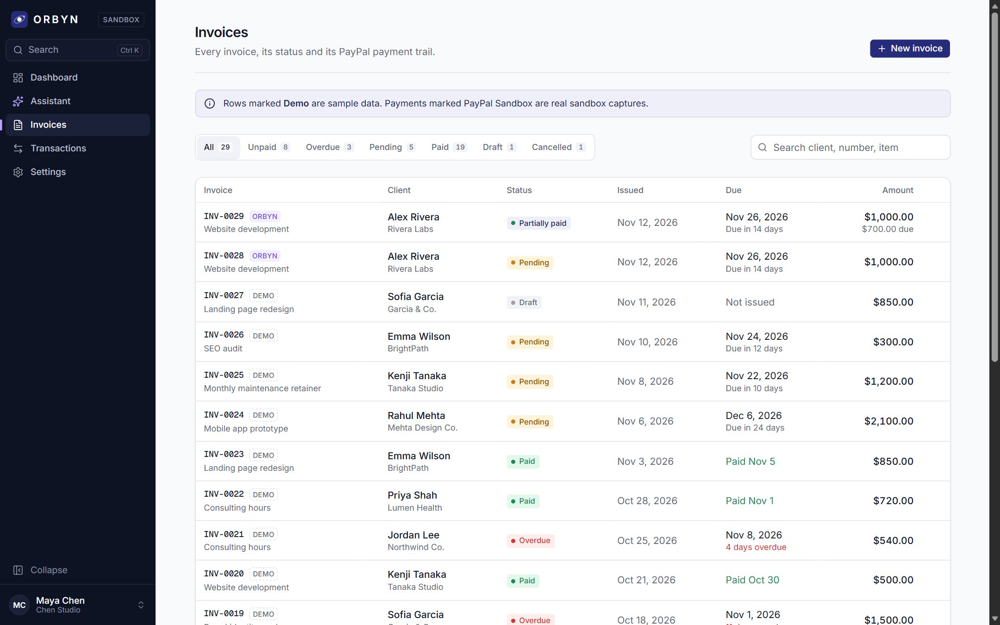<br /><sub><b>Invoices.</b> Tabs with counts, search, pagination. Demo rows are labelled.</sub></td>
</tr>
<tr>
<td>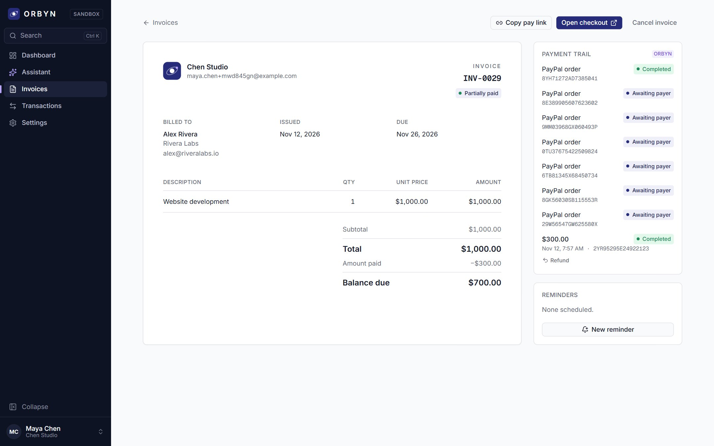<br /><sub><b>Invoice.</b> Partially paid, with the PayPal order and capture trail.</sub></td>
<td>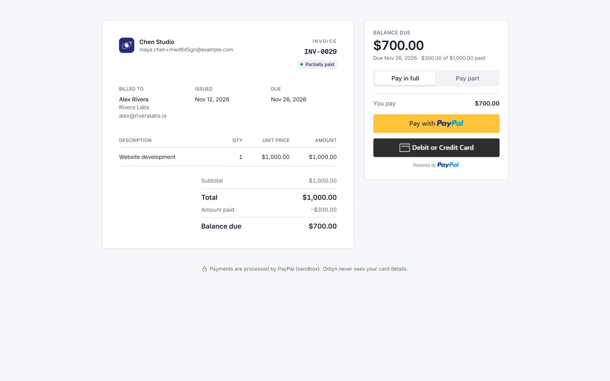<br /><sub><b>Pay page.</b> What the client sees: pay in full or part, through PayPal.</sub></td>
</tr>
<tr>
<td>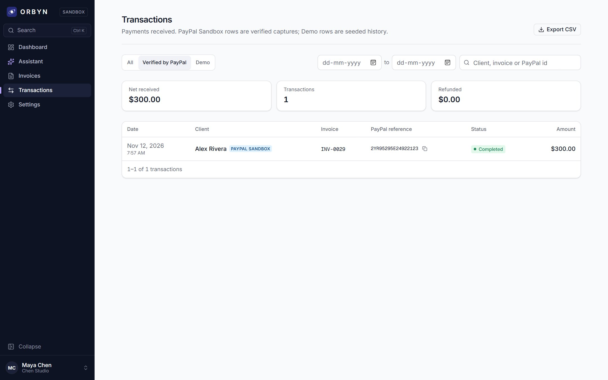<br /><sub><b>Transactions.</b> Verified PayPal captures with copyable ids and CSV export.</sub></td>
<td>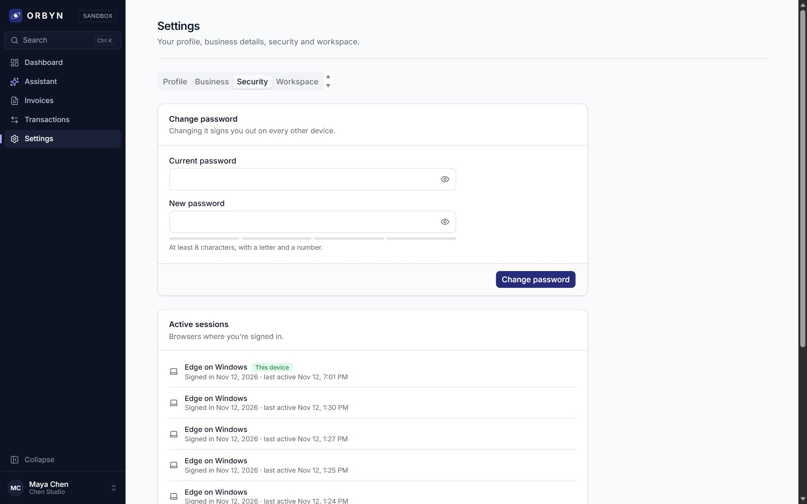<br /><sub><b>Settings.</b> Change password and sign out other sessions.</sub></td>
</tr>
<tr>
<td>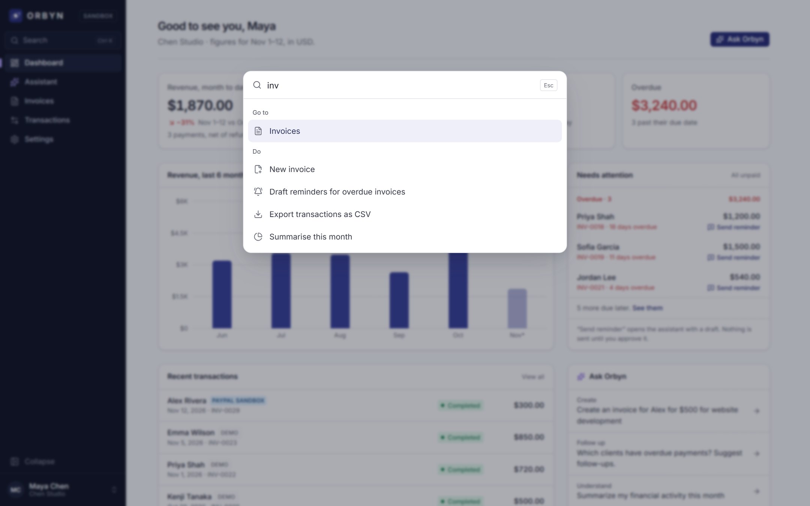<br /><sub><b>Command palette.</b> Ctrl/⌘ K from anywhere.</sub></td>
<td>
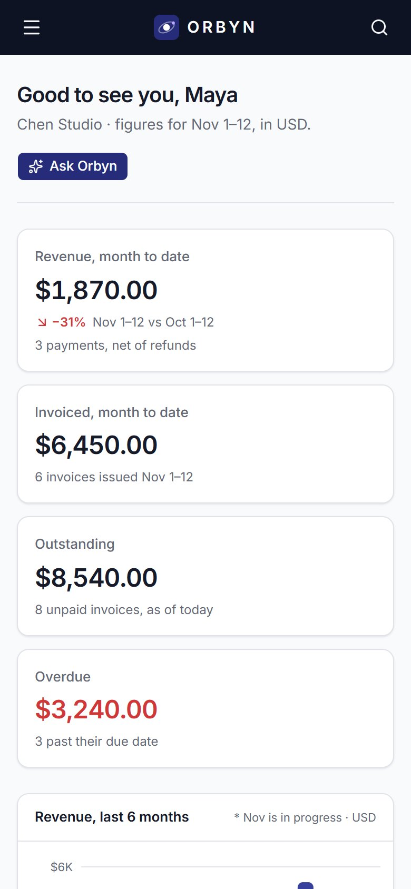
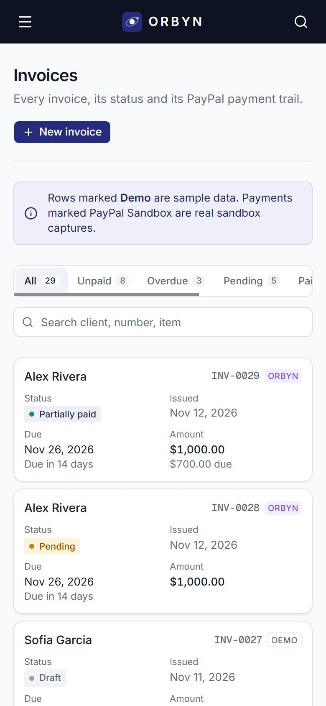<br /><sub><b>Phone.</b> Drawer navigation and stacked cards.</sub>
</td>
</tr>
</table>

<sub>Screens are from the live deployment.</sub>

## How the approval gate works

The model proposes; the server decides and PayPal confirms.

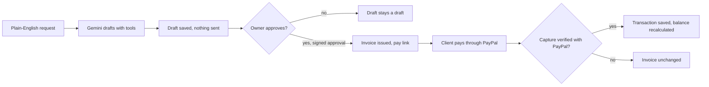

- Tools run with the signed-in workspace captured on the server; the model never supplies an account id.
- Every number in the assistant's cards comes straight from a tool result, not from model text.
- Paid status comes only from a verified capture. Captures are unique by PayPal capture id, so a retry can't count twice.
- Every query is scoped by workspace, with a test proving one account cannot touch another's data.

## Architecture

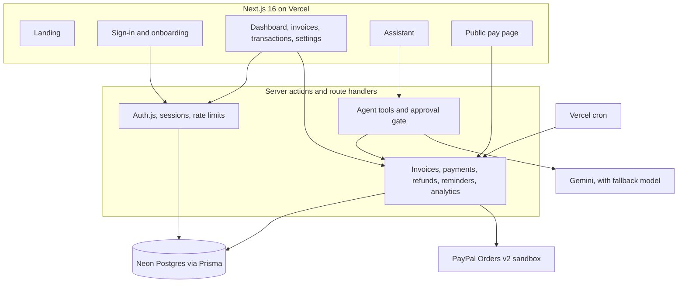

More detail: [Architecture and data model](docs/ARCHITECTURE.md) · [Demo script](docs/DEMO.md).

## Quick start

Requires **Node 24.7 or newer** (argon2id comes from Node's built-in `crypto`) and a Postgres database.

```bash
npm install
cp .env.example .env        # fill in DATABASE_URL, SESSION_SECRET, TOOL_APPROVAL_SECRET, Gemini and PayPal sandbox keys
npm run db:migrate          # create the tables
npm run dev                 # http://localhost:3200
```

Click **Try the live demo** for a seeded guest workspace, or sign up for an empty one. Password-reset links print to the server console in development, since no email provider is configured.

The app runs on port **3200** so it never collides with another local project's cached pages on 3000.

### Environment variables

All keys live in `.env`, which is never committed. [`.env.example`](.env.example) documents each one.

| Variable | Needed for | Notes |
|---|---|---|
| `DATABASE_URL` | everything | Postgres connection string |
| `SESSION_SECRET` | sign-in | 32+ random characters (`AUTH_SECRET` also accepted) |
| `TOOL_APPROVAL_SECRET` | assistant | 32+ random bytes; signs approvals |
| `APP_URL` | pay and reset links | `http://localhost:3200` locally |
| `GOOGLE_GENERATIVE_AI_API_KEY` | assistant | Gemini key |
| `GEMINI_MODEL`, `GEMINI_FALLBACK_MODEL` | assistant | default `gemini-flash-latest`, fallback `gemini-flash-lite-latest` |
| `PAYPAL_ENV`, `PAYPAL_BASE_URL` | payments | `sandbox`, `https://api-m.sandbox.paypal.com` |
| `PAYPAL_CLIENT_ID`, `PAYPAL_CLIENT_SECRET`, `NEXT_PUBLIC_PAYPAL_CLIENT_ID` | payments | Sandbox REST app |
| `PAYPAL_WEBHOOK_ID` | webhooks (optional) | needs a public URL |
| `CRON_SECRET` | reminders sweep | protects `/api/cron/reminders` |
| `GOOGLE_CLIENT_ID`, `GOOGLE_CLIENT_SECRET` | Google sign-in (optional) | button hidden when empty |

## Tests

```bash
npm test               # 55 passing
npm run lint
npx tsc --noEmit
npm run build
```

Unit tests cover money maths, partial payments, reminders, the assistant's message merging and the intent preview. Database tests (run against `DATABASE_URL`, cleaned up afterwards, skipped if it is unset) cover sign-up, login, wrong passwords, password reset expiry and single use, session revocation, demo-to-account conversion, rate limits, route protection and **workspace isolation**.

## Tech

Next.js 16 · React 19 · TypeScript · Tailwind CSS 4 · shadcn/Radix · Prisma 7 · Neon Postgres · Auth.js v5 · AI SDK 7 · Gemini · PayPal Orders v2 · Recharts · GSAP · Lenis · cmdk · Vitest

## Project layout

```
src/app          routes: landing, auth, onboarding, app, pay page, API
src/components   ui primitives, shared building blocks, feature folders
src/server       agent, auth, PayPal client, services, seeding, session
src/lib          helpers shared by browser and server
prisma           schema and migrations
tests            Vitest unit and database tests
docs             architecture, demo, screenshots and film
```

## Live deployment

App: https://orbyn-mu.vercel.app (Vercel) · Database: Neon Postgres · Payments: PayPal **sandbox** only, no real money moves. The daily reminders sweep runs as a Vercel cron.

<div align="center"><sub>Built for the PayPal AI Hackathon.</sub></div>
