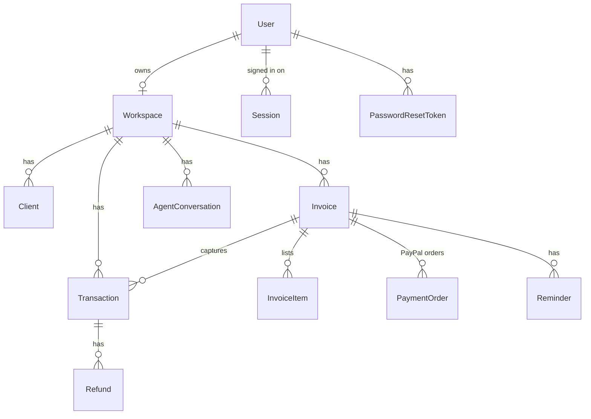
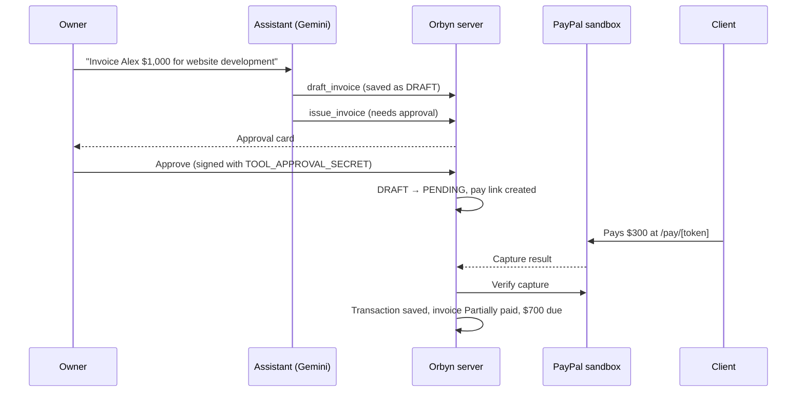

# Architecture

Orbyn is one Next.js 16 app (App Router, Cache Components, Turbopack) backed by Postgres through Prisma 7. Everything runs on Vercel: pages, server actions and route handlers. The database is Neon.

## Folder map

```
src/
  app/
    page.tsx, landing.css      Landing page (GSAP + Lenis, Instrument Serif)
    (auth)/                    /login, /signup, /forgot-password, /reset-password
    (app)/                     Signed-in area: dashboard, assistant, invoices, transactions, settings
    (legal)/                   /terms, /privacy (placeholder copy)
    onboarding/                Three-step setup after sign-up
    pay/[token]/               Public pay page a client opens from a pay link
    actions/                   Server actions: auth, onboarding, settings, invoices, payments, reminders
    api/
      agent/chat/              Assistant streaming endpoint (AI SDK)
      auth/[...nextauth]/      Auth.js handlers
      paypal/webhook/          PayPal webhook receiver (verified)
      cron/reminders/          Daily sweep, Bearer CRON_SECRET
      transactions/export/     CSV export
  auth.ts                      Auth.js config (credentials, demo guest, optional Google)
  proxy.ts                     Route guard (Next 16's renamed middleware)
  components/
    ui/                        Design-system primitives (shadcn/Radix based)
    shared/                    App-wide building blocks: DataTable, KpiCard, EmptyState, StatusBadge…
    shell/                     Sidebar, account menu, command palette, demo banner, welcome tour
    landing/ auth/ onboarding/ assistant/ invoices/ pay/ reminders/ settings/ transactions/ dashboard/
  lib/                         Pure helpers shared by browser and server (money, dates, schemas)
  server/
    agent/                     Assistant tools, instructions, conversation storage, model fallback
    auth/                      Accounts, argon2id passwords, rate limits, CSRF origin check
    paypal/                    PayPal Orders v2 client
    services/                  Invoices, payments, refunds, reminders, analytics, audit log
    seed/                      Demo workspace seeding
    session.ts                 Who is signed in: user + workspace + session id
prisma/                        Schema, migrations, seed script
tests/                         Vitest: unit tests and database tests
docs/                          This folder
```

## Data model



- Every business row carries a `workspaceId`, and every query filters by the workspace of the signed-in person. `tests/auth.db.test.ts` proves one workspace cannot read, change, remind on or refund another's records.
- Money is integer minor units (cents) everywhere.
- `source` marks where a row came from: `SEEDED` rows are demo data and are labelled Demo in the UI; only `PAYPAL_SANDBOX` transactions are verified captures.

## Sign-in and sessions

- Auth.js v5 with a JWT that carries only two ids: the user and a `Session` row. Each request checks that row, so signing out elsewhere, a password reset or deleting the account takes effect on the next request.
- Passwords: argon2id from Node's built-in `crypto` (Node 24.7+), no native dependency.
- Rate limits live in Postgres (`RateLimit` table) so they hold across serverless instances: login, sign-up, password reset and demo creation.
- Password reset tokens: random, stored as SHA-256, single use, 30-minute expiry. The reply never reveals whether an email is registered.
- CSRF: Next.js checks the Origin on server actions; the chat route checks it by hand.
- `src/proxy.ts` redirects signed-out visitors to `/login?next=…`. Pages and actions check the session again on the server.

## The approval gate



- The model can only draft. Issuing an invoice or scheduling a reminder needs the owner's approval in the UI, and approvals are HMAC-signed by the server so a client cannot forge one.
- The server is the source of truth for chat history; the browser only sends its newest message.
- An invoice is marked paid only from a verified PayPal capture, never from the client's word. Captures are de-duplicated by PayPal capture id.
- When Gemini's main model answers "high demand", `src/server/agent/model.ts` retries the same request on a lighter model before any text is streamed.

## Deployment

| Piece | Where |
|---|---|
| App | Vercel project `orbyn`, production at https://orbyn-mu.vercel.app |
| Database | Neon Postgres, created through the Vercel Marketplace |
| Cron | `vercel.json` runs `/api/cron/reminders` daily at 08:00 UTC |
| Secrets | Vercel environment variables, documented in `.env.example` |

Deploy with `vercel deploy --prod` from the repo root. Apply new migrations first with `prisma migrate deploy` against the unpooled Neon URL.
